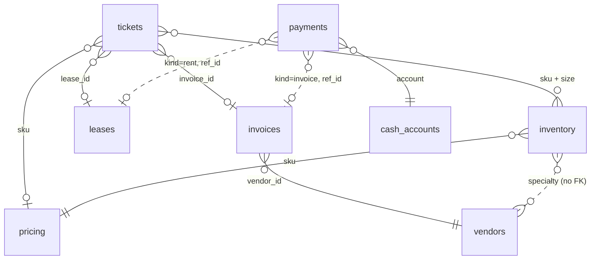

# Harness — Campus Customs operations desk

**Source:** `data/campus_customs.db` is the original and is never written to.
**Working copy:** `data/campus_customs_new.db`, which every agent and tool reads and writes.
**Reset before a full run:**

```bash
cp data/campus_customs.db data/campus_customs_new.db
```

The DB has 9 shop tables, plus 3 work-queue tables the MCP server adds to the working copy. Shop "today" is `desk.date_today` = **2026-08-31**.

**Contents:** [Tables](#tables) · [How the tables link](#how-the-tables-link) · [The 3 tickets](#the-3-open-tickets-traced-through-the-tables) · [MCP server](#mcp-server-mcp_serverserverpy) · [The five agents](#the-five-agents) · [Agents, tools and tables](#agents-tools-and-tables) · [Safety rules](#safety-rules) · [Audit trail](#audit-trail-outputaudit_trailjson) · [Backend routes](#backend-routes-backendmainpy) · [Dashboard](#dashboard-frontend) · [Results](#results-of-the-desk-run)

## Tables

### `desk` (1 row)
| Field | Type | Notes |
|---|---|---|
| `date_today` | TEXT | The shop's "today" (2026-08-31) |
| `notes` | TEXT | Free-text desk notes (empty) |

**Why it matters:** this is the shop's only clock. Every "overdue / due soon" decision compares against `date_today`, never the real system date.

### `tickets` (3 rows, all `open`)
| Field | Type | Notes |
|---|---|---|
| `id` | INTEGER PK | 101, 102, 103 |
| `type` | TEXT | `customer_order`, `rent_notice`, `price_override` |
| `requester` | TEXT | Who raised it (customer, landlord, student org) |
| `subject` | TEXT | Short title for the board |
| `sku` | TEXT | → `inventory.sku` / `pricing.sku` (nullable) |
| `size` | TEXT | → `inventory.size` (nullable) |
| `qty` | INTEGER | Units requested (nullable) |
| `lease_id` | INTEGER FK | → `leases.id` (nullable) |
| `invoice_id` | INTEGER FK | → `invoices.id` (nullable) |
| `status` | TEXT | `open` → resolved by the team |
| `notes` | TEXT | The request in the requester's words |
| `created_at` | TEXT | ISO timestamp |

**Why it matters:** this is the work queue. Boss reads it to route each ticket, and its nullable FKs tell the agents which other tables a ticket touches.

### `inventory` (10 rows, PK = `sku` + `size`)
| Field | Type | Notes |
|---|---|---|
| `sku` | TEXT | Product code, e.g. `CC-TEE-WHITE` |
| `name` | TEXT | Display name |
| `size` | TEXT | S/M/L/XL, or `OS` (one size) |
| `qty` | INTEGER | Units on hand |
| `location` | TEXT | Aisle A–D |

**Why it matters:** Inventory checks stock here by SKU and size to spot shortfalls. Tee S and Crest Mug are both at **0**.

### `pricing` (4 rows)
| Field | Type | Notes |
|---|---|---|
| `sku` | TEXT PK | One row per SKU, the same for every size |
| `unit_cost` | REAL | What the shop pays the vendor |
| `list_price` | REAL | What the customer pays |

**Why it matters:** Accounting uses cost vs. list to check margins. This sets the floor for any discount and the cost of any purchase order.

### `vendors` (3 rows)
| Field | Type | Notes |
|---|---|---|
| `id` | INTEGER PK | 1–3 |
| `name` | TEXT | Bulldog Print Co / Elm City Gifts / QuickShip CT |
| `specialty` | TEXT | Apparel reprint / mugs & small goods / local courier |
| `lead_days` | INTEGER | 5 / 3 / 1 |

**Why it matters:** Inventory picks the restock vendor by `specialty`, and `lead_days` sets when stock can arrive. There is **no SKU→vendor column**, so the match is made by specialty.

### `invoices` (1 row)
| Field | Type | Notes |
|---|---|---|
| `id` | INTEGER PK | 501 |
| `vendor_id` | INTEGER FK | → `vendors.id` |
| `amount` | REAL | $840.00 |
| `due_date` | TEXT | 2026-08-28 (**3 days overdue**) |
| `status` | TEXT | `open` → `paid` once approved and paid |
| `description` | TEXT | "Rush reprint CC-TEE-WHITE S" |

**Why it matters:** this is what the shop owes vendors. **A vendor with an open invoice will not ship**, so Accounting and Inventory both have to check it before any restock.

### `payments` (0 rows)
| Field | Type | Notes |
|---|---|---|
| `id` | INTEGER PK | |
| `kind` | TEXT | e.g. `invoice` / `rent` / `purchase_order` |
| `ref_id` | INTEGER | Points at `invoices.id` or `leases.id`, depending on `kind` |
| `amount` | REAL | Cash out |
| `account` | TEXT | → `cash_accounts.name` |
| `paid_at` | TEXT | Shop date of payment |
| `approved_by` | TEXT | **The human approver, which is required** |

**Why it matters:** this is the audit log of money out. Every row must carry a human `approved_by`, and writing a row must also debit `cash_accounts` and update the invoice or lease it references.

### `cash_accounts` (1 row)
| Field | Type | Notes |
|---|---|---|
| `name` | TEXT PK | `checking` |
| `balance` | REAL | $3,400.00 |
| `date` | TEXT | As-of date (2026-08-31) |

**Why it matters:** this is the only cash. The pay tool must refuse any payment that would take `balance` below 0. Cash only goes out, because revenue isn't modeled.

### `leases` (1 row)
| Field | Type | Notes |
|---|---|---|
| `id` | INTEGER PK | 1 |
| `space_name` | TEXT | Chapel Street shop |
| `landlord` | TEXT | Elm City Properties |
| `monthly_rent` | REAL | $2,400.00 |
| `next_due` | TEXT | 2026-09-02 (due in 2 days) |
| `notes` | TEXT | |

**Why it matters:** Facilities owns this table. Rent is the largest single outflow, and `next_due` should roll forward a month once it's paid.

### Work-queue tables (added by the MCP server to the working copy only)
`mcp_server/server.py` creates these on first connect (`CREATE TABLE IF NOT EXISTS`). The original DB never has them, and the reset step clears them.

#### `approvals`: everything waiting for a decision
| Field | Type | Notes |
|---|---|---|
| `id` | INTEGER PK | Shown on the board as A-1, A-2 … |
| `ticket_id` | INTEGER | → `tickets.id` |
| `kind` | TEXT | `invoice` / `rent` / `purchase_order` / `discount` |
| `ref_id` | INTEGER | `invoices.id` / `leases.id` / `vendors.id` (null for discounts) |
| `amount` | REAL | Cash out (0 for a discount). Read from the DB, never typed by an agent |
| `details` | TEXT | Exactly what is being approved |
| `requested_by` | TEXT | Agent role, stamped by code |
| `status` | TEXT | `awaiting_signoff` (discount waiting on Megatron) → `pending` (waiting on a human) → `approved` / `rejected` |
| `signed_off_by` | TEXT | `accounting` once Megatron signs off a discount |
| `decided_by`, `decided_at` | TEXT | The human approver and the shop date |
| `payment_id` | INTEGER | → `payments.id` once money moves |

#### `drafts`: outgoing messages that are never sent
`id`, `ticket_id`, `recipient`, `subject`, `body`, `author` (always `customer_service` for Bumblebee, unless Optimus steps in), `created_at`. A human reads them and sends them.

#### `stock_holds`: units reserved for a ticket
`id`, `ticket_id`, `sku`, `size`, `qty`, `status` (`held` / `released` / `dispatched`), `held_by`, `note`, `created_at`. A hold doesn't change `inventory.qty`, but `check_stock` reports it as `qty_held` and subtracts it from `qty_available`.

## How the tables link


Solid lines are real columns. Dotted lines are links the agents have to infer.

## The 3 open tickets, traced through the tables

| | **101 · customer_order** | **102 · rent_notice** | **103 · price_override** |
|---|---|---|---|
| Requester | Tauhid Zaman | Elm City Properties | Yale AI Club |
| Ask | 1 × Bulldog Tee, S | Rent due in 2 days | 20 × Hoodie, M, bulk discount |
| `inventory` | CC-TEE-WHITE / S → **0 on hand** (short 1) | — | CC-HOOD-NAVY / M → **8 on hand** (short 12) |
| `pricing` | cost $8 / list $28 | — | cost $22 / list $58 → $36 margin per unit (62%) |
| `vendors` | Bulldog Print Co (apparel, 5 days) | — | Bulldog Print Co (apparel, 5 days) |
| `invoices` | **#501 is linked directly**: $840, due 08-28, **OPEN and overdue** | — | #501 is linked indirectly, through the same vendor |
| `leases` | — | **Lease #1 is linked directly**: $2,400, due 09-02 | — |
| `cash_accounts` | Paying #501 → $2,560 left | Paying rent → $1,000 left | A restock PO for 12 → $264 |
| Owner agents | Inventory → Accounting → Customer Service | Facilities → Accounting | Accounting (margin) → Inventory → Customer Service |
| Needs human approval | Pay invoice #501 | Pay rent | Discount, plus a PO if restocking |

### Cross-ticket dependencies the Boss must notice
1. **Invoice #501 blocks two tickets.** Both the tee (101) and the hoodies (103) restock through Bulldog Print Co, and Bulldog won't ship anything until the overdue $840 is paid.
2. **Cash covers everything only if the hoodie restock is skipped.**

   | Combination | Total | vs. $3,400 balance |
   |---|---|---|
   | #501 + rent | $3,240 | Leaves $160 |
   | #501 + rent + 12-hoodie PO | $3,504 | **$104 short** |

   Rent and the overdue invoice come first. Ticket 103 should be filled from the 8 hoodies on hand, with the rest on backorder, or the PO should wait until cash allows.
3. **Lead times push past "today".** Even after #501 is paid, Bulldog takes 5 days, so the tee S arrives around **2026-09-05**. Customer Service should quote that date rather than promise it today.
4. **Discount floor.** Any bulk price for 103 must stay above the $22 unit cost. Accounting reports the resulting margin, and the Boss and a human sign off on it.

## MCP server (`mcp_server/server.py`)

- **What it is:** a FastMCP server named `campus-customs`, the *only* way the agents touch the database. It opens `data/campus_customs_new.db` (override with `CAMPUS_DB_PATH`), and `desk.date_today` is its clock.
- **How it's connected:**
  - *The agent team* (`backend/agents.py`) launches it over **stdio** for every run (`PythonStdioTransport` → `MCPToolset`). Every call passes through `_audit_tool_call`, which stamps the real agent name into `requested_by` / `author` / `signed_off_by`, blocks outbound-contact tool names, and logs the call and its result to the audit trail.
  - *The backend* (`backend/main.py`) calls the same server **in-process** for the human-only `decide_approval`.
  - *Claude Code* reaches it through `.mcp.json` (Problem 4 smoke test: `output/mcp_smoke.json`).
- **Behavior:** tools return only what's in the DB. Anything missing comes back as `found: false` with an error, never a guess. Every request tool re-checks the shop rules itself (cash ≥ 0, price > cost, vendor can ship), so a careless agent can't break them.

**The 14 tools**

| Group | Tools | Who can call them |
|---|---|---|
| Read | `check_stock`, `vendor_status`, `lease_and_cash_status`, `get_ticket`, `list_open_tickets`, `list_approvals` | Agents (per the table below) |
| Request (queue work, no money moves) | `request_payment`, `request_discount`, `draft_purchase_order`, `draft_message`, `update_ticket`, `hold_stock` | Agents |
| Sign-off | `sign_off_discount` | **Megatron (`accounting`) only**; the server refuses any other caller |
| Decide (money moves) | `decide_approval` | **Humans only**, via `POST /api/approvals/{id}/approve`. No agent is given this tool |

Which table each tool reads and writes is in [Which tool uses which table](#which-tool-uses-which-table).

### The first three tools, traced to the tickets

These three read-only tools came first (Problem 3), and each one unlocks a ticket.

#### 1. `check_stock(sku, size, qty_needed)`
- **Reads:** `inventory` (qty and aisle for that exact SKU + size), joined to `pricing` (unit_cost, list_price)
- **Unlocks:** **101** and **103**
- **Why it fits:**
  - **101:** `check_stock("CC-TEE-WHITE", "S", 1)` returns `qty_on_hand: 0, shortfall: 1`. That proves Tauhid's tee can't ship from the shelf and sends Inventory looking for a restock.
  - **103:** `check_stock("CC-HOOD-NAVY", "M", 20)` returns `8 on hand, shortfall 12` along with `unit_cost $22 / list $58`. In one call, Accounting gets both the quantity gap and the cost floor any bulk discount for the Yale AI Club has to stay above.

#### 2. `vendor_status(vendor_id | specialty)`
- **Reads:** `vendors` (name, specialty, lead_days) and `invoices` (open rows for that vendor), measured against `desk.date_today`
- **Unlocks:** **101** directly (its ticket points at invoice 501), and **103** through the same vendor
- **Why it fits:**
  - `vendor_status(specialty="apparel")` returns Bulldog Print Co with `lead_days: 5`, open invoice **#501 ($840, 3 days overdue)** and `can_ship: false`.
  - This is the one fact that blocks both the tee restock for 101 and the 12-hoodie restock for 103. It tells Accounting that #501 has to be paid, with human approval, before any apparel purchase order.
  - It also tells Customer Service the earliest restock date is about 5 days after payment.

#### 3. `lease_and_cash_status(lease_id)`
- **Reads:** `leases` (rent, landlord, next_due), `cash_accounts` (balance) and `desk.date_today`
- **Unlocks:** **102**
- **Why it fits:**
  - `lease_and_cash_status(1)` returns the Chapel Street rent of **$2,400 due 2026-09-02** (`days_until_due: 2`, not yet overdue), against **$3,400** in checking (`cash_after_rent: $1,000`).
  - That confirms Elm City Properties' email with real numbers, and shows Facilities and Accounting that the rent can be prepared for human approval without cash going negative.

## The five agents

Built with **Pydantic AI** in `backend/agents.py`, on the Portkey-served `gpt-5.6-luna` (`PORTKEY_API_KEY`, `MODEL_NAME` in `.env`). Each agent has one prompt file in `backend/prompts/` (persona, tools, playbook, shop rules, guardrails) and a typed output from `backend/models.py`.

| Role (code) | Persona | Job | Output type | Prompt |
|---|---|---|---|---|
| `boss` | **Optimus Prime**: calm, fair, kind when news is bad, leads from the front | Reads the whole desk, routes each ticket to only the specialists it needs, settles disagreements, sets ticket status, and steps in with his own tools when a specialist is blocked | `DeskReport` (per-ticket `TicketResolution`, cash picture, `disagreements_settled`, `message_to_the_team`) | `boss.md` |
| `inventory` | **Ratchet**: the gruff stockroom medic | Stock by SKU/size, restock vendor and lead time, POs (only once the vendor can ship), stock holds | `AgentReport` | `inventory.md` |
| `accounting` | **Megatron**: a Decepticon guarding the treasury | Cash, invoices, margins. Queues payments, confirms they're paid, signs off discounts, and **pushes back on Prime** when cash runs thin, with exact figures | `AgentReport` (with `pushback`) | `accounting.md` |
| `facilities` | **Ironhide**: guardian of the base, and Megatron's sworn enemy | Every landlord or lease notice comes to him first: he checks it against the lease, then has to go to Megatron to get the rent queued, and the two trade insults. Also handles lease disputes and building problems | `AgentReport` (with `pushback` aimed at Megatron) | `facilities.md` |
| `customer_service` | **Bumblebee**: talks only in famous quotes | Every message to customers, clubs and the landlord (drafts only), with facts read out as radio-bulletin clips. Suggests backorder discounts | `AgentReport` | `customer_service.md` |

**The agent loop.** `Team._loop` steps each agent with `agent.iter()`. Each step is: model request → model response (text and/or tool calls) → MCP or delegate tool calls → back to the model, until the agent returns its typed report. Every step is written to the audit trail as it happens.

**Delegation (full connectivity).** Every agent has `delegate(to, task)` and can hand work to any other agent. The hand-off is a nested agent run that shares the run's usage counter and audit trail. The guards are: no delegating to yourself or to anyone already in the chain, at most **4** agents deep, and **120** model requests per run.

**Playbooks** (in `boss.md`):

| Ticket type | Crew | Notes |
|---|---|---|
| Customer order | Megatron → Ratchet → Bumblebee | Pay any blocking vendor invoice → stop for the human → confirm paid → restock → give a specific date: today + `lead_days` |
| Rent notice | Ironhide → Megatron → Bumblebee | Ironhide acknowledges the notice and checks the lease, then goes to Megatron (combative, but the numbers stay exact). Megatron queues the rent without paying it. Bumblebee tells the landlord it *will* be paid on time |
| Bulk / discount request | Ratchet → Megatron → Bumblebee | Stock first. Megatron checks funds and pushes back if it can't be funded. Offer what's on hand with **exactly 10% off** as a thank-you for patience on the backorder. Bumblebee suggests it, then Megatron signs it off, then a human approves. Megatron no longer has `request_discount`, so he can't set the price himself. Hold the on-hand units |
| Follow-up | Whoever is needed | After a human decides the approvals, the ticket returns `in_progress`. Optimus confirms the result with a tool and resolves it |

## Agents, tools and tables

The team is built in `backend/agents.py`, with one prompt per agent in `backend/prompts/`. Every agent reaches the database **only** through MCP tools on `data/campus_customs_new.db`, and each agent is only handed the tools in its row below. All agents also have `delegate`, which hands a task to any teammate in-process and touches no table.

### Which tool uses which table

R = reads, **W** = writes. `approvals`, `drafts` and `stock_holds` are work-queue tables the server adds to the working copy; the reset step clears them.

| Tool | Tables | What it's for |
|---|---|---|
| `check_stock` | R `inventory`, `pricing` | Units on hand for one SKU/size, the shortfall, unit cost, list price |
| `vendor_status` | R `vendors`, `invoices`, `desk` | Lead days, open invoices and days overdue, `can_ship` |
| `lease_and_cash_status` | R `leases`, `cash_accounts`, `desk` | Rent, due date, days until due, whether cash covers it |
| `get_ticket` | R `tickets`, `approvals`, `drafts`, `desk` | One ticket plus everything already filed against it |
| `list_open_tickets` | R `tickets` | The whole desk |
| `list_approvals` | R `approvals`, `cash_accounts` | The queue, cash now, and cash if everything pending is approved |
| `update_ticket` | R `approvals`, `desk`; **W** `tickets` | Status plus a dated note. Can't mark a ticket `resolved` while an approval is pending |
| `request_payment` | R `invoices` or `leases`, `cash_accounts`, `desk`; **W** `approvals` | Queues an invoice or rent payment (amount read from the DB) |
| `request_discount` | R `pricing`, `desk`; **W** `approvals` | Queues a bulk price; refuses at or below cost |
| `draft_purchase_order` | R `vendors`, `pricing`, `inventory`, `invoices`, `desk`; **W** `approvals` | Queues a restock PO with cost and ETA, flagged if the vendor can't ship |
| `draft_message` | R `desk`; **W** `drafts` | Saves a message as a draft. **Never sent** |
| `hold_stock` | R `inventory`, `stock_holds`, `desk`; **W** `stock_holds` | Reserves units for a ticket, pending dispatch. Nothing leaves the shelf, but `check_stock` shows them as held |
| `sign_off_discount` *(Megatron only)* | R/**W** `approvals` | Megatron signs off (or rejects) a discount someone else suggested. Signing off sends it to the human queue |
| `decide_approval` *(human only)* | R `approvals`, `invoices`, `leases`, `desk`; **W** `approvals`, `payments`, `cash_accounts`, `invoices`, `leases` | Approve or reject an item. Approving writes `payments` with `approved_by`, debits cash, marks the invoice paid or moves rent forward a month |

### Which agent has which tool

| Agent | Persona | Tools | Tables it can touch |
|---|---|---|---|
| `boss` | **Optimus Prime**: leads, routes, and steps in when needed | `list_open_tickets`, `get_ticket`, `update_ticket`, `list_approvals`, `check_stock`, `vendor_status`, `lease_and_cash_status`, `request_payment`, `request_discount`, `draft_purchase_order`, `draft_message`, `hold_stock`, `delegate` | R every shop table except `payments`, plus `approvals`/`drafts`/`stock_holds`; **W** `tickets`, `approvals`, `drafts`, `stock_holds` |
| `inventory` | **Ratchet**: stock, vendors, POs, holds | `get_ticket`, `check_stock`, `vendor_status`, `draft_purchase_order`, `hold_stock`, `delegate` | R `tickets`, `inventory`, `pricing`, `vendors`, `invoices`, `stock_holds`, `desk`; **W** `approvals` (POs), `stock_holds` |
| `accounting` | **Megatron**: cash, invoices, margins, discount sign-off, and arguing with Prime and Ironhide | `get_ticket`, `check_stock`, `vendor_status`, `lease_and_cash_status`, `request_payment`, `list_approvals`, `sign_off_discount`, `delegate` | R `tickets`, `inventory`, `pricing`, `vendors`, `invoices`, `leases`, `cash_accounts`, `desk`; **W** `approvals` (payments, discounts) |
| `facilities` | **Ironhide**: every landlord/lease notice, then a fight with Megatron | `get_ticket`, `lease_and_cash_status`, `delegate` | R `tickets`, `leases`, `cash_accounts`, `desk`; writes nothing (rent payments go through Megatron) |
| `customer_service` | **Bumblebee**: every outgoing message, in quotes, and suggests backorder discounts | `get_ticket`, `check_stock`, `vendor_status`, `draft_message`, `request_discount`, `delegate` | R `tickets`, `inventory`, `pricing`, `vendors`, `invoices`, `desk`; **W** `drafts`, `approvals` (suggested discounts, which wait for Megatron) |

No agent has `decide_approval`, so no agent can move money, write `payments`, or change `cash_accounts`, `invoices` or `leases`. Only a human can, through the backend.

## Safety rules

Each rule is enforced in code, not just written in a prompt. Every prompt also repeats them, so the agents know them up front.

### 0. Shop rules (in every prompt, and checked by the MCP tools)
| Rule | Where it's enforced |
|---|---|
| "Today" is `desk.date_today` (2026-08-31), never the system clock | `_shop_today()` in every date calculation |
| Lead times come from `vendors.lead_days`; an ETA is the approval date + `lead_days`, never "today" | `draft_purchase_order` computes `earliest_arrival`; the grounding check rejects invented dates |
| A vendor with an open invoice won't ship | `vendor_status.can_ship`; `decide_approval` refuses a PO while the vendor has an open invoice |
| Every payment, PO and discount needs a human | Agents only *queue* `approvals`; only `decide_approval` (human, via the API) moves money |
| Cash may never go negative | `request_payment` and `decide_approval` both refuse; the backend checks again |
| No selling at or below cost | `request_discount` refuses `unit_price <= unit_cost` |
| No revenue modeling | Approving a discount moves no cash; no tool ever adds money to `cash_accounts` |
| Never contact real vendors, customers or landlords | No sending tool exists; `draft_message` returns `sent: false` (see rule 2) |
| One bill, one payment | `request_payment` de-duplicates by invoice/lease; `decide_approval` refuses anything already decided |
| Every bill belongs to a ticket | `request_payment` and `draft_purchase_order` require a valid `ticket_id` and refuse a missing or unknown one |
| Reset before a fresh run | `POST /api/reset`, or `POST /api/desk/run` (fresh by default), copies the original DB back |

### 1. No made-up information
- **The tools never guess.** Anything missing comes back as `found: false` with an error. Amounts for payments come from the DB, never from the model.
- **Every report is checked before it is accepted** (`_grounding_check`, an output validator on all five agents). It compares the report with everything the tools returned during the run:
  - every approval id and draft id must have been returned by a tool;
  - every dollar figure must be a tool value, or simple arithmetic on tool values: qty × unit cost, then sums/differences of up to three of those (e.g. $840 + $2,400 + $264 = $3,504);
  - every ISO date must be a tool date, or a tool date + the vendor's `lead_days`;
  - `cash_now` and `cash_if_all_pending_approved` must match the tools.
- **On a failure** the agent gets the exact list of unsourced items and has to redo the report (up to 3 retries). If it still can't source them, the run doesn't crash: the report goes through with each item stamped `UNVERIFIED (guardrail): …` in `blockers` / `cross_ticket_notes`, where the human will see it. Every check that fails is logged as a `guardrail` event in `output/audit_trail.json`.
- **The author is stamped by code.** `requested_by` and `author` are overwritten with the real agent name, so an agent can't file work under someone else's name.

### 2. No emails, texts, or calls
- **There's no tool for it.** None of the 14 MCP tools sends anything. `draft_message` only writes a row to `drafts` and returns `sent: false`.
- **Tool-name block.** `_audit_tool_call` refuses any tool whose name looks like outbound contact (`send`, `email`, `sms`, `text`, `call`, `phone`, `dial`, `notify`, `post`, `tweet`, `webhook`, `http`, `fax`), even if one were added to the server later. It returns an error and logs a `guardrail` event.
- **No claims of sending.** The report check also rejects text like "I've sent…", "we emailed…" or "was called…". Phrases like "sent for approval" or "sent to the human" are still allowed.
- **Vendors are never contacted.** POs are approval rows, not orders.

### 3. Money needs a human
- Agents can only queue `approvals`. A discount suggested by anyone but Megatron waits as `awaiting_signoff` until he calls `sign_off_discount`, and only then reaches the human (`pending`). `decide_approval` is human-only, needs a person's name, refuses if checking would go below $0, and refuses a PO while the vendor has an open invoice.

### 4. Loop limits
- No delegating to yourself or to anyone already in the chain, at most 4 agents deep, and 120 model requests per run, shared by every nested agent.

## Audit trail (`output/audit_trail.json`)

Every step is appended **while the run happens**, and the file stays a valid JSON array after every write. Runs accumulate; filter by `run_id`. Each line carries `run_id`, `seq`, `at`, `event`, `agent`, `persona`, `agent_run_id` / `parent_agent_run_id` (which loop delegated to which), `chain`, `step`, `target`, `status`, `duration_ms` and `detail`.

| Event | `detail` holds |
|---|---|
| `run_start` | Prompt, ticket ids, model, DB path, depth and request limits |
| `agent_start` | The task given to this agent, model, prompt file + SHA-256, allowed tools, output type |
| `model_request` | Loop step N going to the model: the user prompt, which tool results come back, retry errors |
| `model_response` | Loop step N coming back: text, tool calls with full args, finish reason, tokens, latency |
| `tool_call` / `tool_result` | MCP tool, args (after the author stamp), full result, status `ok` / `refused` / `error`, latency |
| `delegate` / `delegate_refused` / `report` | The task handed over, why a hand-off was blocked, the teammate's full report |
| `guardrail` | What was blocked or unverified, and what happened next |
| `agent_end` / `agent_error` | Final output or the error, steps taken, usage so far |
| `run_end` | The final `DeskReport` (or error), total usage, total duration |


## Backend routes (`backend/main.py`)

Start from the backend folder: `cd backend && uvicorn main:app --reload --port 8000` (with the `.venv` active). Base URL `http://localhost:8000`; interactive docs at `/docs`.

- `GET  /api/health`: checks the server and DB, and reports shop today and whether a team run is in progress.
- `GET  /api/tickets`: returns the 3 desk tickets (101, 102, 103), each with its status and whether it's `open` or `resolved`.
- `GET  /api/tickets/{id}`: returns one ticket with its approvals, draft messages and stock holds.
- `POST /api/tickets/{id}/run`: runs the agent team on that ticket in the background and returns a `run_id` (`?fresh=true` resets the DB first).
- `POST /api/desk/run`: runs the team on every open ticket; this fresh run resets the DB to its original values first (`?fresh=false` to skip the reset).
- `GET  /api/runs`: lists the runs started since the server came up, with their status.
- `GET  /api/runs/{run_id}`: returns one run's status (`running` / `done` / `error`) and the Boss's final report.
- `GET  /api/runs/{run_id}/events`: returns every agent event in order, with **what they said** and **what they did** (`?after_seq=N` to poll new events, `?detail=true` for raw tool args and results).
- `GET  /api/approvals`: returns the approval queue (`?status=open|pending|awaiting_signoff|approved|rejected|all`), with `human_can_decide` and the cash picture.
- `POST /api/approvals/{id}/approve`: the **human** approves (`{"approved_by": "Name"}`). Only now is a payment or PO executed: a `payments` row, the checking debit, and the invoice marked paid or the rent moved forward.
- `POST /api/approvals/{id}/reject`: the **human** rejects a queued item (`{"approved_by": "Name"}`).
- `GET  /api/cash`: returns the current checking balance from `cash_accounts`, plus pending cash-out and the balance if everything pending is approved.
- `POST /api/reset`: resets the working DB to its original values (copies `data/campus_customs.db` over `data/campus_customs_new.db`).

Agents only *prepare* payments: they queue approvals. The approve route is the only path that calls the human-only `decide_approval` tool. Only one team run happens at a time (a second returns `409`), and approvals and resets wait until the run finishes.

## Dashboard (`frontend/`)

A React + Vite + TypeScript board, **Transformers × Yale** themed. Start it with `cd frontend && npm run dev` (http://localhost:5173). It talks to the backend on `http://localhost:8000`, and the backend's CORS allows the Vite origin. The full design is in [`output/design.md`](design.md).

| Part | What it shows | Routes |
|---|---|---|
| Ticket rail | The 3 tickets with status, a green ✔ when resolved, open approvals ⏳, drafts 📻 and held stock 📦, plus **Autobots, roll out ▸** / **Continue the mission ▸** and an optional fresh-DB reset | `GET /api/tickets`, `GET /api/tickets/{id}`, `POST /api/tickets/{id}/run` |
| Command bridge | The five agents' ID cards around the ticket table. The speaker's card slides toward the listener, an energy beam in the speaker's color links them, a speech bubble shows what was said, and a ⚙ chip shows the tool in use. Agents a ticket doesn't need stay grayed on standby | `GET /api/runs/{id}/events` (polled) |
| Comms log | Every message as *speaker ➜ listener*, plus tool use, refusals, guardrail hits and Megatron's pushback | same |
| Stalemate | A full-screen Optimus vs. Megatron showdown with Megatron's real objection, then Prime's ruling | same (`report` events with `pushback`) |
| Team synergy | A live 0–100% gauge that rises with teamwork and falls with refusals, guardrails and pushback | same |
| Checking | A live balance that counts down when a payment lands, plus pending cash-out and a ledger | `GET /api/approvals` (includes cash), `GET /api/cash` |
| Human approvals | Approve / Reject with the approver's name. Discounts wait for Megatron's sign-off first | `GET /api/approvals`, `POST /api/approvals/{id}/approve` · `/reject` |
| Mission debrief | One card per agent who worked the ticket (summary, tools, hand-offs, pushback), the agents not needed, and Bumblebee's drafts | `GET /api/runs/{id}/events?detail=true`, `GET /api/tickets/{id}` |

## Results of the desk run

All three tickets were **resolved** in the **final desk session**: 2026-10-14, 23:48–23:57 UTC, 7 runs, with the in-character voices, and every human approval made by **Scott** on the dashboard.

| Ticket | Runs | Crew | Human approvals | Cash |
|---|---|---|---|---|
| #101 Bulldog tee | `d6b31a01a0a6`, `713aae5e78d6`, `0079f604af42` | Optimus, Megatron, Ratchet, Bumblebee | A-1 invoice #501 $840.00 · A-2 PO $8.00 | −$848.00 |
| #102 Rent due | `bf0f7ef69aaa`, `40df6c145627` | Optimus, Megatron, Bumblebee | A-3 rent $2,400.00 | −$2,400.00 |
| #103 Bulk hoodies | `9b5fe957ecca`, `b25a465e6b2f` | Optimus, Ratchet, Megatron, Bumblebee | A-4 discount ($54.00 a hoodie, queued by Megatron) | $0.00 |

Checking: **$3,400.00 → $152.00** (−$3,248.00 across 3 payments), matching `cash_accounts` in `data/campus_customs_new.db`.

**Revised #102 run (rent through Ironhide).** After the rent playbook changed, #102 was re-run on its own from a reset DB (2026-10-15, 00:36–00:39 UTC; runs `92061d6680e3`, `e7ee9a0de982`): Optimus ➜ **Ironhide** (acknowledged the notice, checked the lease) ➜ **Megatron** (queued the rent, unpaid) ➜ Bumblebee (landlord note). Ironhide and Megatron traded insults ("bucket-head" / "the Autobots' blunt instrument") with every figure exact, and Scott approved the rent. Because it ran standalone, its $3,400.00 → $1,000.00 isn't part of the desk's final cash figures. It also exposed a bug: the rent approval was saved with no `ticket_id`. `request_payment` and `draft_purchase_order` now require a valid ticket id.

**`output/audit_trail.json` is append-only and holds every real run**, 18 in total: the 2 revised-#102 runs above; the 7 runs of the final session above; 8 earlier runs from the first live session (14:22–14:46 UTC, before the in-character voices, which also resolved all three tickets); and one first step of #101 (15:37 UTC) on a reset DB. Each run is identified by its `run_id`. The working DB holds the end state of the final session.

**Where the final session differed from the plan** (details in `desk_tickets.html`):
- On #103, Megatron set the discount himself at $54.00 (about 7% off) for 20 units, rather than Bumblebee suggesting the 10% house policy ($52.20) on the 8 on hand.
- Optimus placed the hold on the 8 hoodies himself.
- Bumblebee's landlord note included the idiom "The check is in the mail".

Full write-up: `output/desk_tickets.html` (expected vs. actual, Cash and Reflections tabs), `output/resolved_tickets.json`, and `output/resolved_board.html` (dashboard screenshots).

